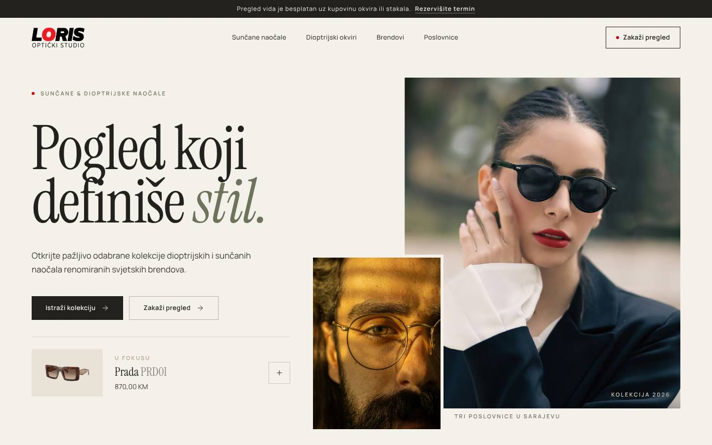

# Optika Loris — Homepage Redesign Concept

An independent, speculative redesign demo of the homepage for **[Optika Loris](https://optikaloris.ba/)**, an optical
studio with three stores in Sarajevo. This is a sales demo for the owners, **not** the official website and not a
working web shop.

> Pogled koji definiše stil.

## What's inside

One premium, fully responsive homepage:

| Section | Highlights |
| --- | --- |
| Header | Genuine Loris logo, sticky header, persistent *Zakaži pregled* CTA, full-screen mobile menu. Nav items for sunglasses/frames pre-select the product filter. |
| Hero | Split editorial composition with overlapping portraits, a "U fokusu" real product that opens the quick-view, and verified key figures. |
| Kolekcije | Asymmetric four-panel mosaic linking to the real collections. |
| Naš pristup | Large serif manifesto with an inline image. |
| Odabrano u studiju | 8 real products with verified prices in KM, category filter, hover image swap, accessible quick-view dialog (focus trap, Esc, focus return) linking to the real product page. |
| Brendovi | Typographic index of verified brands linked to the store's brand pages. |
| Pregled vida | *Vaš vid zaslužuje posebnu pažnju.* — verified service facts + CTA to the existing booking page. |
| Poslovnice | Interactive index of the three verified stores with phone and map links. |
| Footer | Contact details, socials and a clear "independent redesign concept" disclaimer. |

Research, reference analysis and design decisions are documented in [`DESIGN_NOTES.md`](./DESIGN_NOTES.md).
Screenshots from the visual review (1440 / 768 / 390 px) are in [`docs/screenshots`](./docs/screenshots).



## Stack

- [Next.js 15](https://nextjs.org/) (App Router, static output) · React 19 · TypeScript
- Tailwind CSS v4 (design tokens in `app/globals.css`)
- [Motion](https://motion.dev/) for restrained reveals, the filter and dialogs (respects `prefers-reduced-motion`)
- Lucide icons · `next/image` (AVIF/WebP) · `next/font` (Instrument Serif + Manrope)

## Run locally

Requires Node.js 18.18+ (tested with Node 22).

```bash
npm install
```

```bash
npm run dev
```

Open <http://localhost:3000>.

Production build:

```bash
npm run build
```

```bash
npm start
```

Checks:

```bash
npm run lint
```

```bash
npm run typecheck
```

## Project structure

```
app/            layout (fonts, metadata), page, global styles & tokens, favicon
components/     one component per homepage section + QuickView, Reveal, Logo, links
lib/data.ts     verified business data: products, prices, brands, stores, contact
public/brand    Optika Loris logo (from optikaloris.ba)
public/images   products/ (optikaloris.ba packshots), editorial/ (Unsplash)
```

To change products, prices or stores, edit `lib/data.ts`.

## Content & credits

- Products, prices (verified 29 Oct 2026), stores, phone numbers and services come from optikaloris.ba.
- Product photographs and the logo belong to Optika Loris.
- Editorial photographs are from [Unsplash](https://unsplash.com/) under the Unsplash License (IDs listed in
  `DESIGN_NOTES.md`). Sarajevo images are city mood shots, not photos of the stores.

## Scope & limitations

- Demo only: no cart, checkout, backend, CMS or real booking — all purchase and booking actions link to the
  existing optikaloris.ba pages.
- Prices are a snapshot and may change on the live shop.
- `npm audit` reports a PostCSS advisory inside Next 15's build tooling; it only affects build-time processing
  of the project's own CSS. Upgrading to Next 16 resolves it.
